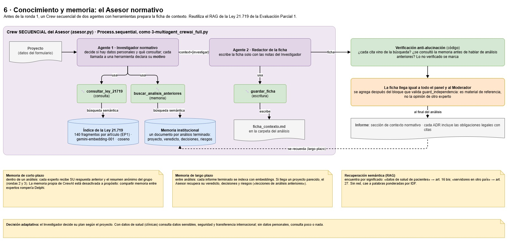

# MultiAgente_Crew_AI — Panel Delphi para Decisiones en Proyectos Informáticos

Sistema que recibe como **input la descripción de un proyecto informático** y aplica la **técnica Delphi** con un panel de **expertos de TI** simulados por LLM de familias distintas: Arquitectura, Cloud, Desarrollo, Seguridad, DevOps, Datos, QA, UX, Gestión e IA. Un **agente Moderador** dirige rondas anónimas para que el panel contraste opiniones sobre las **decisiones clave del proyecto**: estilo de arquitectura, proveedor cloud, stack, base de datos, estrategia de despliegue, seguridad, plazos, etc.

**Objetivo: tomar mejores decisiones antes de construir.** El sistema no entrega una opinión aislada. Entrega:

- **Decisiones recomendadas** con su nivel de consenso: *firme*, *condicionada* o *abierta*.
- **ADR** (*Architecture Decision Records*) listos para incorporar al repositorio del proyecto.
- **Riesgos técnicos** priorizados y los **desacuerdos** que conviene resolver con una prueba de concepto (*PoC*) o un *spike*.

| Pieza | Tecnología |
|-------|------------|
| Agente Moderador + panel multiagente | CrewAI `Process.hierarchical` con `manager_agent` propio, un Crew por experto y ronda (base: `4-multiagent_crewai_hierarchical.py`, IL2.3) |
| Diversidad de modelos | Un LLM de una familia distinta por bloque del `.env` (hoy: Gemini, Gemma y GPT-OSS, vía Google AI Studio y Groq) |
| Backend / API | FastAPI: ejecuta los análisis en segundo plano y los persiste |
| Frontend | Streamlit: configurar, lanzar, seguir en vivo, ver decisiones y ADR, y comparar |

Se construye **directamente la versión final**, sin versiones intermedias.

**Equipo:** Pamela · Jenaro · Juan

---

## 0. Cómo funciona, explicado sin tecnicismos

Esta sección es para quien no sabe nada de inteligencia artificial. Las secciones siguientes son la documentación técnica.


### El problema

Antes de construir un sistema informático hay que tomar decisiones difíciles de revertir: cómo organizar el programa, dónde alojarlo, con qué tecnologías hacerlo. Si las toma una sola persona, su opinión pesa demasiado y sus puntos ciegos pasan a ser los del proyecto. Lo ideal es consultar a varios especialistas, pero eso es caro y lento, y en una reunión el que habla más fuerte suele arrastrar al resto.

### La idea: un comité que opina por separado

El sistema aplica el **método Delphi**, una técnica que se usa desde los años 50 para lograr acuerdos entre expertos:

1. Cada experto responde un cuestionario **por separado**, sin saber qué opinan los demás.
2. Un moderador junta las respuestas y le devuelve a cada uno un **resumen anónimo** ("el grupo opina mayoritariamente esto, y estos son los argumentos").
3. Cada experto puede **mantener o cambiar** su respuesta. Si se aleja mucho del grupo, debe explicar por qué.
4. Se repite hasta que hay acuerdo o hasta un máximo de rondas.

Como nadie sabe quién dijo qué, nadie se deja llevar por el cargo o la personalidad de otro. Solo pesan los argumentos.

### ¿Quiénes son los "expertos"?

No son personas. Son programas de **inteligencia artificial** del mismo tipo que ChatGPT, llamados **modelos de lenguaje** (en inglés, *LLM*). Un modelo de lenguaje aprendió a partir de enormes cantidades de texto: lee una pregunta y escribe una respuesta razonada.

A cada uno se le da un **rol** con instrucciones que describen su especialidad y sus prioridades. Por ejemplo, al experto en seguridad se le pide que priorice proteger los datos aunque cueste más tiempo, y al experto en desarrollo, que priorice entregar rápido. Los roles tienen prioridades distintas a propósito, como pasaría con especialistas reales, para que haya algo que discutir. Hay 10 roles posibles (arquitectura, nube, desarrollo, seguridad, operación, datos, calidad, experiencia de usuario, gestión e IA), y en cada análisis participan de 5 a 7.

### ¿Por qué cada experto usa una IA distinta?

Si los cinco expertos fueran la misma IA con distinto rol, compartirían las mismas costumbres y puntos ciegos, y su "acuerdo" sería engañoso: sería una sola opinión repetida cinco veces. Es como pedirle una segunda opinión a la misma persona. Por eso el sistema mezcla IA de **empresas distintas** (hoy: Gemini y Gemma de Google, y GPT-OSS de OpenAI), y nunca les asigna la misma IA a dos roles que suelen pensar parecido.

### El Moderador

Es otra IA que organiza el proceso: lee el proyecto, decide cuáles son las preguntas importantes y le entrega el cuestionario a cada experto. Lo que **no** puede hacer es tan importante como lo que hace:

- **No puede cambiar lo que recibe cada experto:** el programa arma el cuestionario de cada uno y se lo entrega "sellado".
- **No puede alterar las respuestas:** el programa las toma directamente del experto.
- **No hace los cálculos ni decide el resultado:** eso lo hace el programa con reglas fijas, siempre igual.

### El Asesor normativo: buscar antes de opinar

Antes de que el panel opine, dos IA más preparan una **ficha de contexto**:

- Un **investigador** decide si el proyecto maneja datos personales (de pacientes, clientes, empleados…). Si los maneja, **busca en la Ley 21.719** de protección de datos personales los artículos que aplican, y **revisa los análisis anteriores** del sistema para ver si hubo proyectos parecidos y qué riesgos tuvieron.
- Un **redactor** escribe la ficha con las citas de los artículos y la guarda.

La búsqueda en la ley reutiliza el trabajo de la **Evaluación Parcial 1** del equipo, que dividió la ley en 140 fragmentos por artículo. La búsqueda es **semántica**: encuentra el artículo por su significado, aunque no use las mismas palabras. Por ejemplo, "datos de salud de pacientes" encuentra el artículo de datos sensibles.

El programa **revisa la ficha antes de usarla**: si cita un artículo que la búsqueda no devolvió, o habla de análisis anteriores sin haberlos consultado, lo marca como "no verificado". Después, todos los expertos reciben la misma ficha, que es material de consulta y no la opinión de otro experto. Cada análisis terminado queda guardado en la **memoria del sistema** para los siguientes.

### Un análisis paso a paso (ejemplo real)


Este es un análisis real hecho con el proyecto de ejemplo de una red de clínicas que quiere un sistema de reservas de horas.

1. **La persona describe su proyecto** en un formulario: objetivo, cantidad de usuarios, plazo (6 meses), presupuesto, equipo (4 personas), normativa (Ley 21.719 de datos de salud) y las dudas que ya tiene.
2. **El sistema sugiere el panel de expertos** según el proyecto, y la persona puede ajustarlo.
3. **El Moderador escribe el cuestionario.** Para las clínicas preguntó, entre otras cosas, por el estilo de arquitectura (*monolito modular* o *microservicios*), el alojamiento (*plataforma gestionada* o *Kubernetes*) y la app móvil (*React Native* o *PWA*), además de preguntas como "¿El diseño de datos cumple la Ley 21.719?".
4. **Ronda 1: cada experto responde por separado** con una nota de 1 a 5 y una justificación. Por ejemplo: *"La entrega en 6 meses es viable si se opta por una arquitectura monolítica modular… el equipo de cuatro personas tiene el perfil adecuado"*.
5. **El programa resume las respuestas** con dos números:
   - La **mediana**, que es el valor del medio. Si las notas son 2, 3, 3, 4 y 5, la mediana es 3.
   - La **dispersión** (*IQR*), que mide qué tan de acuerdo están. Si es 1 o menos, se considera que hay **consenso**.
6. **Ronda 2: cada experto ve el resumen anónimo** y puede reconsiderar. En la pregunta sobre la Ley 21.719 pasó esto:

   | | Arquitectura | Nube | Desarrollo | Seguridad | Operación | Mediana |
   |---|:-:|:-:|:-:|:-:|:-:|:-:|
   | Ronda 1 | 3 | 3 | 4 | **2** | **5** | 3 |
   | Ronda 2 | 3 | 3 | 4 | **3** | **4** | 3 |

   Los dos expertos más alejados se acercaron al grupo. Así es como Delphi construye acuerdo.
7. **El programa clasifica cada decisión** con una regla fija:
   - ✅ **Firme:** hay acuerdo, la opción ganadora tiene nota 4 o más y le saca al menos un punto a la segunda. *Se recomienda adoptarla.*
   - ⚠️ **Condicionada:** hay acuerdo, pero la ventaja es pequeña o la nota es solo intermedia. *Se adopta con condiciones o se revisa más adelante.*
   - ❓ **Abierta:** no hubo acuerdo. *Conviene una prueba pequeña (prueba de concepto) antes de decidir.*

   Para las clínicas, las tres decisiones salieron **firmes**: monolito modular (nota 5 contra 2 de microservicios), plataforma gestionada (5 contra 2) y PWA para la app móvil (4 contra 3). Es razonable para un equipo pequeño con poco plazo y poco presupuesto.
8. **El sistema da un veredicto de viabilidad.** A todos los expertos se les hace siempre una pregunta más: *¿qué tan viable es el proyecto tal como está planteado?* Con la nota final, el programa dice si es ✅ **viable** (4 o más), ⚠️ **viable con condiciones** (3), ⛔ **no viable** (menos de 3) o ❓ **en discusión** (si no hubo acuerdo), y explica por qué con los argumentos y los riesgos más graves.
9. **El sistema entrega un informe** con las decisiones, los riesgos que detectaron los expertos (por ejemplo, incumplir la ley de datos de salud), los desacuerdos y un **ADR** por decisión: un documento breve que deja registrado qué se decidió, qué otras opciones había y por qué.

### ¿Qué hace la IA y qué hace el programa?

| Tarea | Lo hace | Por qué |
|---|---|---|
| Escribir el cuestionario | IA (Moderador) | Requiere entender el proyecto |
| Opinar y justificar | IA (cada experto) | Es el juicio experto |
| Agrupar riesgos parecidos | IA (Moderador) | Requiere entender el texto |
| Armar lo que recibe cada experto | Programa | Garantiza que nadie vea opiniones ajenas |
| Calcular medianas y consenso | Programa | Los números deben ser exactos y repetibles |
| Decidir si hay otra ronda | Programa (la IA solo opina en casos dudosos) | Las reglas no deben depender de la IA |
| Clasificar firme, condicionada o abierta | Programa | Una regla fija, igual para todos los proyectos |
| Dar el veredicto de viabilidad | Programa (con la nota que dieron los expertos) | Una regla fija: la IA opina, el programa concluye |

### Qué se ve en pantalla

- **Nuevo análisis:** se describe el proyecto (o se elige un ejemplo), se ajusta el panel y se inicia.
- **En vivo:** el análisis aparece por etapas (preparación y cada ronda). Solo queda abierta la etapa en curso; las terminadas se pliegan con un resumen (por ejemplo, "Ronda 1 · ✔ terminada · consenso 60 %"). Las respuestas llegan identificadas solo como E1, E2…; el "modo auditor" muestra qué rol e IA hay detrás de cada uno.
- **Decisiones:** arriba, el **veredicto de viabilidad** en una caja de color; luego las tarjetas de cada decisión, los **riesgos ordenados por gravedad** (🔴 alta, 🟠 media, 🟡 baja, con su mitigación), los gráficos de convergencia y las descargas del informe.
- **Historial:** análisis anteriores, y la comparación de dos de ellos (por ejemplo, el mismo proyecto con un panel de una sola IA contra uno de varias).

### Cuánto tarda y por qué

Un análisis completo tarda **unos 5 a 10 minutos**: los expertos responden al mismo tiempo, así que cada ronda dura lo que tarda el más lento (Gemma, 1 a 2 minutos). Las IA usadas son las de los **planes gratuitos** de cada empresa, que limitan cuántas preguntas por minuto y por día se pueden hacer. Cuando una IA llega a su límite, el sistema espera y reintenta, o le pasa ese experto a otra IA, y lo deja registrado. Para una demostración se puede usar el **modo simulado**, que recorre todo el proceso en segundos con respuestas ficticias.

### Lo que el sistema no hace

- **No reemplaza el juicio humano.** Es un apoyo para decidir mejor y dejar registrado el porqué, no una orden.
- **La IA puede equivocarse** o basarse en supuestos. Las justificaciones están a la vista para revisarlas.
- **Un acuerdo no garantiza que la decisión sea correcta.** Mezclar IA distintas reduce el riesgo de un falso acuerdo, pero no lo elimina. Por eso el sistema también mide el sesgo de cada IA (cuánto se aleja del grupo).

### Glosario

| Término | Significado |
|---|---|
| **IA / modelo de lenguaje (LLM)** | Programa que aprendió de grandes cantidades de texto y responde preguntas escribiendo. |
| **Agente** | Una IA con un rol y una tarea, por ejemplo "experto en seguridad que responde este cuestionario". |
| **Familia de modelos** | IA de un mismo origen (por ejemplo, Gemini de Google). Distintas familias "piensan" distinto. |
| **Prompt** | Las instrucciones y la información que se le entregan a la IA. |
| **API / API key** | La forma en que un programa se conecta con el servicio de IA de una empresa, y la clave personal para usarlo. |
| **Mediana** | El valor del medio cuando las notas se ordenan de menor a mayor. |
| **IQR (rango intercuartílico)** | Cuánto se separan las notas del medio. Si es 1 o menos, hay consenso. |
| **ADR** | *Architecture Decision Record:* documento breve que registra una decisión técnica y sus razones. |
| **PoC / spike** | Prueba pequeña y rápida para resolver una duda antes de comprometerse. |
| **CrewAI** | La herramienta con la que se programa el equipo de agentes (Moderador y expertos). |
| **Frontend / backend** | La parte que se ve (las pantallas) y la parte que trabaja detrás (el motor y la API). |

---

## Guía de estudio

Esta sección es para estudiar el proyecto y preparar la defensa. Cada concepto se explica en tres partes: **qué es**, **cómo se usa aquí** y **dónde verlo en el código**. Al final hay un recorrido de un análisis por los archivos y preguntas probables de la evaluación, con dónde está la respuesta.

**Cómo leer el README:** si es la primera vez, lean la sección 0 y luego esta guía. Las secciones 1 a 4 son la referencia técnica (reglas, arquitectura, modelos y contratos), la 8 explica cómo ejecutar todo y la 9 tiene los resultados con modelos reales. La [§1.8](#18-agentes-herramientas-memoria-y-planificación-indicadores-il21-a-il24) relaciona cada indicador de la rúbrica con el código.

### Los conceptos, uno por uno

#### 1. Modelo de lenguaje (LLM) y prompt

- **Qué es:** un programa que recibe un texto (el *prompt*) y genera una respuesta. No "sabe" nada fijo: responde según lo que aprendió y según lo que dice el prompt.
- **Cómo se usa aquí:** cada experto, el Moderador y el Asesor son llamadas a un LLM con un prompt distinto. Se les pide responder en **JSON**, así el programa puede leer las notas sin interpretar texto libre.
- **En el código:** `config.py` (`crear_llm`) crea cada LLM a partir del `.env`, y `llm_io.py` (`extraer_json`, `validar`) saca el JSON de la respuesta, quita el razonamiento (`<think>`, `<thought>`) y lo valida con Pydantic.

#### 2. Agente, tarea y equipo (CrewAI)

- **Qué es:** en CrewAI, un **Agent** es un LLM con un rol (`role`), un objetivo (`goal`), una historia (`backstory`) que define su forma de pensar, un límite de intentos (`max_iter`) y, opcionalmente, herramientas (`tools`). Una **Task** es un encargo con su descripción y el resultado esperado (`expected_output`). Un **Crew** junta agentes y tareas y las ejecuta según un **Process**.
- **Cómo se usa aquí:** hay dos tipos de equipo, los mismos que vimos en clase:
  - **`Process.hierarchical`** (como `4-multiagent_crewai_hierarchical.py`): un jefe (`manager_agent`) decide a quién delegar. Lo usamos en **cada ronda**: el **Moderador** es el jefe y cada **experto** es un trabajador.
  - **`Process.sequential`** (como `3-multiagent_crewai_full.py`): las tareas corren en orden y la segunda recibe la primera con `context=[tarea_anterior]`. Lo usamos en el **Asesor normativo**: primero investiga y después redacta.
- **En el código:** `crew.py` (`crear_moderador`, `crear_worker`, `crear_tarea_experto`, `crear_crew_ronda`) y `asesor.py` (`crear_asesor`, `crear_redactor`, `preparar_ficha`).

#### 3. Herramientas (tools)

- **Qué es:** funciones que un agente puede **decidir** llamar por su cuenta. En CrewAI se escriben como una clase `BaseTool` con un nombre, una descripción (que el LLM lee para saber cuándo usarla), un esquema de parámetros (`args_schema`) y el método `_run`, que hace el trabajo.
- **Cómo se usa aquí:**
  - **Consulta:** `consultar_ley_21719` busca artículos de la ley.
  - **Memoria:** `buscar_analisis_anteriores` busca proyectos parecidos ya analizados.
  - **Escritura:** `guardar_ficha` guarda la ficha en un archivo.
  - **Delegación:** el Moderador usa la herramienta que CrewAI le da a todo jefe para delegar trabajo.
  - **Razonamiento numérico:** `DelphiStatsTool` envuelve la estadística de `stats.py`. Como CrewAI no deja que el jefe tenga herramientas propias, el motor llama a esas funciones directamente.
  - Las herramientas tienen **estado**, como `SimulatedEmailTool` de la clase: registran cada uso (entrada, motivo y resultado), y ese registro se muestra en la página En vivo.
- **En el código:** `asesor.py` (`ConsultarLeyTool`, `BuscarAnalisisAnterioresTool`, `GuardarFichaTool`) y `tools.py` (`DelphiStatsTool`).
- **Lección aprendida:** CrewAI declara las herramientas en "modo estricto", donde todos los parámetros son obligatorios. Con un parámetro opcional, o con uno solo, el modelo de Groq generaba llamadas mal formadas. Por eso cada herramienta tiene dos parámetros obligatorios, y uno es el `motivo`.

#### 4. Memoria de corto y largo plazo

- **Qué es:** la **memoria de corto plazo** es lo que el sistema recuerda **dentro** de una misma tarea larga. La **de largo plazo** es lo que recuerda **entre** tareas distintas.
- **Cómo se usa aquí:**
  - **Corto plazo:** en las rondas 2 y 3, cada experto recibe **su** respuesta anterior y el resumen anónimo del grupo. Así mantiene la coherencia y, si se aleja del grupo, debe justificarlo.
  - **Largo plazo:** cada análisis terminado se guarda en la **memoria institucional**, y el Asesor lo recupera cuando llega un proyecto parecido.
  - **Por qué la memoria propia de CrewAI está apagada (`memory=False`):** si los expertos compartieran memoria, uno podría ver lo que dijo otro, y eso rompe el método Delphi.
- **En el código:** `engine.py` (`_prompt_experto` arma la memoria de corto plazo) y `conocimiento.py` (`BaseConocimiento.recordar` y `buscar_analisis`, guardados en `outputs/memoria/`).

#### 5. RAG: búsqueda semántica en la Ley 21.719

- **Qué es:** *RAG* (Retrieval-Augmented Generation) significa **buscar primero** la información relevante y **dársela** al LLM, en vez de confiar en lo que el modelo "recuerda".
  - **Embedding:** convierte un texto en una lista de números (aquí, 3.072) que representa su significado. Textos con significado parecido quedan cerca.
  - **Similitud coseno:** mide qué tan cerca están dos de esas listas: 1 es idéntico y 0 es que no tienen relación.
- **Cómo se usa aquí:** la ley se dividió en 140 fragmentos por artículo en la **Evaluación Parcial 1**. Cada fragmento tiene su embedding (`gemini-embedding-001`). La pregunta del agente también se convierte en embedding y se devuelven los fragmentos más cercanos, con su cita. Por ejemplo, "datos de salud de pacientes" encuentra el **art. 16 bis**, aunque las palabras no sean las mismas. Si no hay conexión a internet, la búsqueda cae a coincidencia de palabras, donde las palabras raras pesan más (IDF).
- **En el código:** `conocimiento.py` (`EmbedderOpenAI`, `IndiceVectorial.buscar`, `cita`), `data/conocimiento/` (fragmentos e índice) y `scripts/indexar_conocimiento.py`, que construye el índice.



#### 6. Alucinaciones y cómo se controlan

- **Qué es:** una *alucinación* ocurre cuando el LLM inventa algo que suena creíble, como un artículo o un análisis que no existe. Nos pasó: cuando una herramienta fallaba, el agente **inventó un análisis anterior**.
- **Cómo se usa aquí:** después del Asesor, el **código** revisa la ficha:
  - Cada cita debe haber salido de la búsqueda.
  - Si menciona análisis anteriores, tiene que haber consultado la memoria.

  Lo que no se pueda verificar queda marcado en la ficha y aparece como aviso en el informe. Además, el prompt pide copiar las citas tal cual y no suponer resultados.
- **En el código:** `asesor.py` (`verificar_ficha`, `_normalizar_cita`).
- **Límite:** la verificación comprueba **de dónde viene** una cita, no si la **interpretación legal** es correcta.

#### 7. El método Delphi en números

- **Mediana:** el valor del medio de las notas ordenadas. Se usa en vez del promedio porque una nota extrema no la mueve.
- **Q1 y Q3:** los cuartiles, es decir, el valor bajo el que queda el 25 % y el 75 % de las notas. El **IQR** (Q3 − Q1) mide la dispersión, y **IQR ≤ 1 cuenta como consenso**.
- **Reglas que aplica el código, no la IA:**
  - Otra ronda si no hay consenso (80 % de los ítems), con un mínimo de 2 rondas y un máximo de 3.
  - **Firme / condicionada / abierta** para cada decisión.
  - **Viable / con condiciones / no viable / en discusión** para el veredicto.
- **En el código:** `stats.py` (`cuartiles`, `es_estable`, `estado_decision`, `veredicto_viabilidad`), `decisiones.py` (`clasificar_decision`, `evaluar_viabilidad`) y `engine.py` (`decidir_continuar`).

#### 8. Independencia de los expertos (lo que hace que esto sea Delphi)

- **Enunciado sellado:** el código arma el prompt de cada experto, y el Moderador solo decide cuándo delegar. Así no puede resumir ni cambiar lo que el experto recibe (`ExpertoDelphi` en `crew.py`).
- **Salida directa:** se usa la respuesta del experto, no la del Moderador, que podría reescribir una nota.
- **`context=[]` y un Crew por experto:** ninguna tarea ve el resultado de otra.
- **`guard_independencia`** (`prompts.py`): rechaza cualquier dato que no esté permitido en el prompt de un experto.

#### 9. Planificación y decisiones adaptativas

- **Planificación:** el Moderador planifica el cuestionario (qué decisiones y qué evaluaciones) y el Asesor planifica sus consultas según el proyecto.
- **Secuenciación por condiciones:** el motor decide si sigue a otra ronda según el consenso, la estabilidad y el mínimo y máximo de rondas.
- **Adaptación a fallas:** si un proveedor responde 429 (límite por minuto) o 500 (error del servidor), el motor espera y reintenta. Si responde 413 (la petición es muy grande) o 404 (el modelo ya no existe), o si una respuesta sigue inválida, **le cambia el modelo al experto**, respetando los roles afines, y lo registra con el evento `cambio_modelo`.
- **En el código:** `engine.py` (`ejecutar_ronda_crewai`, `con_reintentos`, `_cambiar_modelo`) y `config.py` (`ModelPool.alternativo`).

#### 10. Paralelismo, API y pantallas en vivo

- **Paralelismo:** los expertos responden al mismo tiempo, en hilos separados, así cada ronda dura lo que tarda el más lento y no la suma. Los eventos se numeran con un candado para que el frontend no se salte ninguno.
- **API:** FastAPI recibe el análisis, lo pone en cola, lo ejecuta en un hilo y lo guarda en disco (`backend/api/`).
- **En vivo:** Streamlit consulta los eventos nuevos cada 2 segundos y muestra solo la etapa en curso (`frontend/pages/2_En_vivo.py`).

### Recorrido de un análisis por el código

1. **Pantalla:** `frontend/pages/1_Nuevo.py` arma la configuración y `api_client.py` la envía a `POST /runs`.
2. **API:** `backend/api/main.py` (`ServicioDelphi.crear`) valida las reglas y la pone en cola, y el hilo trabajador llama a `DelphiEngine.run`.
3. **Modelos:** `config.py` (`ModelPool.para_run`) asigna un modelo a cada experto.
4. **Asesor:** `engine.py` (`_preparar_contexto`) llama a `asesor.py` (`preparar_ficha`). Investigador y Redactor usan sus herramientas y `verificar_ficha` revisa las citas.
5. **Cuestionario:** el Moderador lo escribe (`moderador_prompts.py`) y el código lo acota y le agrega la pregunta de viabilidad (`acotar_cuestionario`, `asegurar_item_viabilidad`).
6. **Rondas:** `ejecutar_ronda_crewai` crea un Crew jerárquico por experto, en paralelo. Cada respuesta se valida y se emite apenas llega (`procesar`).
7. **Resumen de la ronda:** `tools.py` y `stats.py` calculan los números, `anonymizer.py` resume los argumentos y `decidir_continuar` decide si hay otra ronda.
8. **Cierre:** `decisiones.py` produce las decisiones, los riesgos y el veredicto, `adr.py` los ADR y `report.py` el informe.
9. **Guardado:** `store.py` guarda todo en `outputs/runs/<id>/` y `conocimiento.py` (`recordar`) lo agrega a la memoria.
10. **Resultados:** `frontend/pages/3_Decisiones.py` muestra el veredicto, las decisiones y los riesgos.

### Preguntas probables y dónde está la respuesta

| Pregunta | Dónde mirar |
|----------|-------------|
| ¿Qué herramientas usa el agente y cómo decide usarlas? | Concepto 3 de esta guía, `asesor.py` y el evento `contexto_preparado` en la página En vivo (muestra cada llamada con su motivo). |
| ¿Cómo implementaron la memoria de corto y de largo plazo? | Concepto 4, `engine._prompt_experto` y `conocimiento.BaseConocimiento.recordar`. Prueba: `test_asesor_y_memoria_de_largo_plazo_en_la_api`. |
| ¿Cómo funciona la recuperación semántica? ¿Por qué embeddings y no búsqueda por palabras? | Concepto 5, `conocimiento.IndiceVectorial.buscar` y los ejemplos de art. 16 bis y art. 27 de la §1.8. |
| ¿Qué relación tiene con la Evaluación Parcial 1? | Concepto 5 y `data/conocimiento/README.md`: se reutilizan los 140 fragmentos y la idea anti-alucinación. |
| ¿Por qué un proceso jerárquico en las rondas y uno secuencial en el Asesor? | Concepto 2: en las rondas el jefe decide la delegación; en el Asesor el orden es fijo (investigar → redactar). |
| ¿Cómo evitan que los expertos se influyan entre sí? | Concepto 8 y la hoja 3 del diagrama. |
| ¿Cómo demuestra el agente decisiones adaptativas? | Concepto 9 y la §9: los tres proyectos dan resultados distintos, el Asesor cambia su plan y hay cambios de modelo registrados. |
| ¿Qué pasa si una IA falla o inventa? | Conceptos 6 y 9, y la hoja 5 del diagrama. |
| ¿Por qué el veredicto lo da el código y no la IA? | Concepto 7: las reglas tienen que ser fijas, repetibles y auditables. |
| ¿Cuáles son las limitaciones? | §9: límites de los planes gratuitos, GPT-OSS solo en la ronda 1 y una verificación que no juzga la interpretación legal. |

---

## 1. Técnica Delphi aplicada a proyectos informáticos

La técnica Delphi es un método estructurado para obtener consenso entre expertos. Sus rasgos esenciales son:

1. **Anonimato:** los expertos no saben quién opinó qué. Así se evita que, por ejemplo, la opinión del arquitecto arrastre al resto.
2. **Iteración:** hay varias rondas de cuestionario.
3. **Retroalimentación controlada:** entre una ronda y otra, el moderador entrega un resumen estadístico y los argumentos anónimos del grupo.
4. **Respuesta estadística del grupo:** se informa la mediana y el rango intercuartílico (IQR), no un promedio.

### 1.1 Panel de expertos de TI

El sistema tiene un **catálogo de 10 expertos**. Para cada proyecto se arma un panel de **5 a 7**: un **núcleo fijo** más los **expertos opcionales** que el proyecto requiera. El sistema sugiere el panel según el input y el usuario puede ajustarlo en el frontend.

| Rol (`id`) | Tipo | Evalúa | Sesgo / prioridad explícita del perfil |
|------------|------|--------|----------------------------------------|
| Arquitecto/a de Software (`arquitectura`) | Núcleo | Estilo arquitectónico (monolito modular, microservicios, serverless, eventos), acoplamiento, escalabilidad, evolución | Prioriza la mantenibilidad a largo plazo y la separación de responsabilidades |
| Experto/a Cloud e Infraestructura (`cloud`) | Núcleo | Proveedor (AWS, Azure, GCP u *on-premise*), IaaS/PaaS/serverless, costos cloud (FinOps), regiones | Prioriza los servicios gestionados y el costo total de propiedad |
| Experto/a en Desarrollo (`desarrollo`) | Núcleo | Lenguajes, frameworks, stack frontend y backend, productividad, deuda técnica | Prioriza la velocidad de entrega y la experiencia del equipo con el stack |
| Experto/a en Ciberseguridad (`seguridad`) | Núcleo | Autenticación y autorización, OWASP, cifrado, protección de datos personales (p. ej., Ley 21.719 en Chile), cumplimiento | Prioriza minimizar la superficie de ataque, aunque cueste plazo |
| Experto/a DevOps / SRE (`devops`) | Núcleo | CI/CD, contenedores, IaC, observabilidad, disponibilidad (SLO), recuperación ante desastres | Prioriza la automatización y la operabilidad en producción |
| Experto/a en Datos (`datos`) | Opcional | Modelado, SQL frente a NoSQL, volumen, analítica, migración de datos | Prioriza la integridad y la consistencia de los datos |
| Experto/a QA / Testing (`qa`) | Opcional | Estrategia de pruebas, automatización, criterios de aceptación, rendimiento | Prioriza la calidad verificable antes de liberar |
| Experto/a UX/UI (`ux`) | Opcional | Usabilidad, accesibilidad (WCAG), flujos, *mobile-first* | Prioriza la experiencia del usuario final |
| Jefe/a de Proyecto / Agile (`gestion`) | Opcional | Alcance, estimación, plazos, metodología, tamaño y *seniority* del equipo | Prioriza el cumplimiento de plazo y presupuesto |
| Experto/a en IA/ML (`ia`) | Opcional | Uso de LLM y modelos, datos de entrenamiento, costos de inferencia, riesgos de la IA | Prioriza el valor medible y el control de las alucinaciones |

> Que los sesgos de los perfiles sean **explícitos y distintos** es intencional: así el panel diverge en la ronda 1, como pasaría con expertos reales, y Delphi tiene algo que hacer converger.

### 1.2 Qué se pregunta: evaluaciones y decisiones

El Moderador genera el cuestionario a partir del proyecto. Los ítems se agrupan en **dimensiones**: Arquitectura, Infraestructura/Cloud, Stack, Datos, Seguridad, Calidad, Operación y Gestión. Hay dos tipos de ítem:

| Tipo | Ejemplo | Respuesta |
|------|---------|-----------|
| **Evaluación** | "¿Qué tan viable es cumplir el plazo de 4 meses con el equipo descrito?" | Likert 1–5 + justificación |
| **Decisión entre alternativas** | "Estilo de arquitectura: (a) monolito modular, (b) microservicios, (c) serverless" | Cada alternativa se puntúa con Likert 1–5 (adecuación al proyecto) + justificación |

**Regla de recomendación para cada decisión** (se calcula en el código, no la decide el LLM):

| Resultado | Condición | Significado |
|-----------|-----------|-------------|
| ✅ **Firme** | La mejor alternativa tiene consenso (IQR ≤ 1), mediana ≥ 4 y supera en ≥ 1 punto a la segunda | Adoptar |
| ⚠️ **Condicionada** | Hay consenso, pero la diferencia con la segunda es < 1, o la mediana es 3 | Adoptar con condiciones o revisarla en un hito definido |
| ❓ **Abierta** | Sin consenso al terminar la última ronda | Resolver con una PoC o un *spike* antes de comprometerse |

### 1.3 Arquitectura del sistema

Diagrama completo en [`docs/arquitectura.drawio`](docs/arquitectura.drawio), en 6 hojas con notas explicativas: **1** visión general, **2** un análisis paso a paso (quién hace cada cosa), **3** una ronda por dentro (CrewAI y por qué los expertos no se influyen), **4** componentes y responsables, **5** modelos de IA y respaldos ante los límites de los planes gratuitos, **6** conocimiento y memoria (el Asesor normativo, sus herramientas, el RAG de la Ley 21.719 y la memoria institucional). Se abre en https://app.diagrams.net o en la extensión Draw.io de VS Code. Las imágenes de [`docs/img/`](docs/img/) son la exportación de esas hojas: si se edita el diagrama, hay que volver a exportarlas.


<details>
<summary>Versión en texto del diagrama</summary>

```
┌─────────────────────────── FRONTEND (Streamlit) ───────────────────────────┐
│ Nuevo análisis │ Ejecución en vivo │ Decisiones y ADR │ Historial/Comparar │
└───────────────────────────────┬────────────────────────────────────────────┘
                                │ HTTP (JSON) — polling de eventos
┌───────────────────────────────▼──────────────── BACKEND (FastAPI) ─────────┐
│  /runs  /runs/{id}  /runs/{id}/eventos  /runs/{id}/informe  /expertos      │
│  RunStore (persistencia)   ·   ejecución en segundo plano   ·   cancelación│
└───────────────────────────────┬────────────────────────────────────────────┘
                                │ DelphiEngine.run(config, on_event)
┌───────────────────────────────▼──────────────── MOTOR DELPHI (CrewAI) ─────┐
│                   ┌─────────────────────────────┐                          │
│                   │      MODERADOR DELPHI       │  manager_agent (sin      │
│                   │ cuestionario · delegación   │  tools: CrewAI no lo     │
│                   │ ¿otra ronda? · riesgos      │  permite); rota 4 keys   │
│                   └──────────────┬──────────────┘                          │
│     ┌──────────┬──────────┬──────┴─────┬───────────┬──────────┐            │
│     ▼          ▼          ▼            ▼           ▼          ▼            │
│ Arquitectura  Cloud   Desarrollo   Seguridad    DevOps    (opcionales:     │
│  (Gemini)   (Gemma)  (GPT-OSS)    (Gemini)    (GPT-OSS)    Datos, QA, UX,  │
│                                                            Gestión, IA)    │
│   Cada experto recibe su enunciado SELLADO y su respuesta se toma directo  │
│   Entre rondas, el código calcula la estadística y anonimiza argumentos    │
│   ModelPool: modelos distintos en roles afines · stats.py: mediana/IQR     │
└────────────────────────────────────────────────────────────────────────────┘
```

</details>

### 1.4 Flujo de una ejecución

1. **Ingesta:** el usuario completa la plantilla del proyecto (§1.6) en el frontend o sube un `.md`.
2. **Panel:** el sistema sugiere los expertos (núcleo más opcionales relevantes) y el usuario confirma o ajusta.
2b. **Asesor normativo** (`asesor.py`, §1.8): un Crew **secuencial** de dos agentes con herramientas consulta la Ley 21.719 (RAG) y la memoria institucional, y guarda una ficha de contexto con citas. El código verifica las citas; la ficha llega igual a todos los expertos y al Moderador.
3. **Cuestionario:** el Moderador identifica las **decisiones clave** y genera los ítems de evaluación y de decisión por dimensión.
4. **Ronda k:** el Moderador delega en cada experto **por separado**, en un Crew jerárquico propio por experto. Cada experto responde en JSON usando *su* modelo.
   - **Enunciado sellado:** el prompt del experto lo arma el código y el Moderador solo decide la delegación. Así no puede resumirlo ni agregarle opiniones ajenas, y tampoco copia miles de tokens en cada delegación.
   - **Salida directa:** la respuesta se toma del experto, no de la respuesta final del Moderador, que podría reescribir puntajes.
5. **Agregación:** el motor calcula, sin LLM, la mediana, Q1, Q3 y el IQR de cada ítem y cada alternativa (`stats.py`, la misma lógica que expone `DelphiStatsTool`). El anonimizador resume los argumentos sin revelar autor ni modelo. Lo hace el código y no el Moderador porque CrewAI no permite que el `manager_agent` tenga herramientas, y así los números son reproducibles.
6. **Decisión de continuar:** el Moderador propone si hace falta otra ronda, y **el código impone los límites**. Si hay otra ronda, cada experto recibe el feedback anónimo (estadísticas y argumentos saneados, nunca texto libre de un LLM) junto con su respuesta anterior.
7. **Informe:** veredicto de viabilidad (calculado por el código a partir de la pregunta fija `VIA-E1`), decisiones recomendadas (firme, condicionada o abierta), ADR con su contexto normativo, riesgos técnicos, evaluación por dimensión, disensos con la PoC sugerida y sesgo por modelo.
8. **Memoria:** el análisis terminado se indexa en la memoria institucional (`outputs/memoria/`), donde lo encontrará el Asesor en los análisis siguientes.

Cada paso emite un **evento**, que el frontend muestra en vivo.

Así funciona una ronda por dentro: un equipo CrewAI por experto, con el enunciado sellado y la respuesta tomada directo del experto.


### 1.5 Reglas Delphi (acordadas por los tres, editables desde el frontend)

| Parámetro | Valor por defecto | Nota |
|-----------|-------------------|------|
| Tamaño del panel | 5 núcleo + hasta 2 opcionales (máx. 7) | Limitado por la cuota gratuita |
| Escala | Likert 1–5 + justificación de 1 a 3 frases | |
| Rondas | mínimo 2, máximo 3 | |
| Consenso por ítem o alternativa | IQR ≤ 1 | |
| Consenso global | ≥ 80 % de los ítems con consenso | |
| Estabilidad | variación de la mediana < 0,5 entre rondas | Criterio alternativo de corte |
| Outliers | Si la respuesta de un experto queda fuera de [Q1, Q3], **debe** justificar si mantiene su postura o la cambia | |
| Diversidad | Modelos de **familias distintas** (§3); los roles afines (Arquitectura–Desarrollo, Cloud–DevOps, Seguridad–Datos) nunca comparten modelo | Evita el falso consenso |
| Independencia | El experto recibe **solo** el proyecto, el cuestionario, su respuesta anterior y el feedback anónimo | El código lo verifica (`guard_independencia`) y sella el enunciado (`ExpertoDelphi` en `crew.py`) |
| Cuestionario | 3 a 5 decisiones clave + 6 a 10 ítems de evaluación | Acotado por la cuota |

### 1.6 Input: plantilla de proyecto informático

`data/proyectos/<nombre>.md` (el frontend ofrece el mismo formulario):

```markdown
# <Nombre del proyecto>
## Objetivo y contexto          ¿Qué problema resuelve? ¿Para quién?
## Usuarios y volumen           usuarios concurrentes, crecimiento esperado, picos
## Requisitos funcionales       los 5–10 principales
## Requisitos no funcionales    disponibilidad, latencia, seguridad, accesibilidad
## Restricciones                presupuesto, plazo, tecnologías obligatorias, cloud existente, normativa
## Equipo                       tamaño, seniority, tecnologías que domina
## Integraciones                sistemas externos, APIs, sistemas legados
## Decisiones a evaluar (opc.)  alternativas que el equipo ya está considerando
```

### 1.7 Output

`outputs/runs/<run_id>/`:

- `informe.md` e `informe.json`: resumen ejecutivo, decisiones recomendadas, evaluación por dimensión, riesgos, disensos y PoC sugeridas, evolución por ronda y sesgo por modelo.
- `adr/ADR-001-<decision>.md`, …: **un ADR por decisión**, con el formato *Contexto · Decisión · Alternativas consideradas · Consecuencias · Estado (Aceptada / Condicionada / Abierta) · Evidencia Delphi* (mediana, IQR y argumentos).
- `rondas.json` y `eventos.jsonl`: trazabilidad completa para auditar.
- `estado.json`: estado del run para la API y el historial.
- `ficha_contexto.md`: la ficha que escribió el Asesor normativo con su herramienta de escritura.

### 1.8 Agentes, herramientas, memoria y planificación (indicadores IL2.1 a IL2.4)

Dónde está cada capacidad que pide la Evaluación Parcial 2 y cómo se comprueba:

| Indicador | Qué se implementó | Dónde | Evidencia |
|-----------|-------------------|-------|-----------|
| **IL2.1 · Herramientas de consulta, escritura y razonamiento** | El Asesor normativo es un Crew **secuencial** de dos agentes (investigador → redactor, con `context=[tarea_anterior]`, como `3-multiagent_crewai_full.py`). Sus herramientas son `BaseTool` de CrewAI con estado, como `SimulatedEmailTool` de la clase: **consulta** `consultar_ley_21719`, **memoria** `buscar_analisis_anteriores` y **escritura** `guardar_ficha`, que escribe `ficha_contexto.md`. El agente decide cuándo y cómo usarlas, y cada llamada declara su `motivo`. El Moderador usa las herramientas de **delegación** de CrewAI (`Process.hierarchical`). El **razonamiento** numérico (mediana, IQR y reglas) lo hacen funciones deterministas (`stats.py`, `DelphiStatsTool`). | `backend/delphi/asesor.py`, `crew.py`, `tools.py` | Evento `contexto_preparado` con cada herramienta usada, su entrada, su motivo y su resultado (página En vivo). Tests en `test_conocimiento.py`. |
| **IL2.2 · Memoria de corto plazo** | Continuidad entre rondas: cada experto recibe **su** respuesta anterior y el resumen anónimo del grupo. Se construye en el código y se valida con `guard_independencia`, y la memoria propia de CrewAI se desactiva a propósito para no romper la independencia Delphi. | `engine.py` (`_prompt_experto`), `prompts.py` | Rondas 2 y 3 del informe, con la justificación obligatoria para los expertos fuera de [Q1, Q3]. |
| **IL2.2 · Memoria de largo plazo** | **Memoria institucional:** cada análisis terminado se indexa con embeddings (proyecto, veredicto, decisiones y riesgos) y el Asesor lo recupera cuando llega un proyecto parecido. | `conocimiento.py` (`BaseConocimiento.recordar`), `outputs/memoria/` | El segundo análisis encuentra al primero (`test_asesor_y_memoria_de_largo_plazo_en_la_api`). |
| **IL2.2 · Recuperación semántica de contexto** | **RAG sobre la Ley 21.719** con los 140 fragmentos de la EP1, `gemini-embedding-001` y similitud coseno. Si no hay red, la búsqueda cae a palabras ponderadas por IDF. | `conocimiento.py`, `data/conocimiento/`, `scripts/indexar_conocimiento.py` | "datos de salud de pacientes" → art. 16 bis; "servidores en otro país" → art. 27; "multas por filtración" → arts. 35 y 37. |
| **IL2.3 · Planificación y decisiones adaptativas** | El Moderador **planifica** el cuestionario. El Asesor **decide su plan de consultas** según el proyecto (si no hay datos personales, consulta menos). El motor **secuencia** las rondas por condiciones (consenso, estabilidad, mínimo y máximo) y **se adapta** a fallas (cambia de modelo ante 429, 413, 404 o respuestas inválidas). | `engine.py`, `asesor.py`, `config.py` | §9: tres proyectos con resultados distintos y cambios de modelo registrados con `cambio_modelo`. |
| **IL2.4 · Documentación y orquestación** | Este README, el diagrama de 5 hojas (§1.3) y la verificación anti-alucinación de la ficha, documentada en `asesor.verificar_ficha`. | `README.md`, `docs/` | — |

---

## 2. Estructura del repositorio

```
MultiAgente_Crew_AI/
├── README.md
├── requirements.txt               # crewai, openai, fastapi, uvicorn, streamlit, plotly, pydantic, python-dotenv
├── .env.example                   # bloques LLM_*_<NOMBRE> (SIN keys reales)
├── .gitignore                     # .env, outputs/, __pycache__/
├── data/
│   ├── plantilla_proyecto.md      # plantilla de input (§1.6)          — Juan
│   ├── proyectos/                 # proyectos informáticos de ejemplo  — Juan
│   └── conocimiento/              # Ley 21.719: 140 fragmentos de la EP1 + índice vectorial (RAG)
├── backend/
│   ├── delphi/
│   │   ├── models.py              # contratos Pydantic (§4)            — los tres
│   │   ├── config.py              # ModelPool (§3)                     — Juan
│   │   ├── stats.py               # mediana, IQR, consenso, estabilidad, regla de recomendación — Juan
│   │   ├── llm_io.py              # parseo/validación JSON + reintento — Juan
│   │   ├── project_loader.py      # parseo de la plantilla → Proyecto  — Juan
│   │   ├── experts.py             # catálogo de 10 expertos TI + sugerir_panel() — Jenaro
│   │   ├── prompts.py             # prompts de experto: ronda 1 y ronda k — Jenaro
│   │   ├── anonymizer.py          # AnonymizerTool + síntesis de argumentos — Jenaro
│   │   ├── bias.py                # sesgo por modelo + experimento de control — Jenaro
│   │   ├── asignacion.py          # reparto de modelos sin roles afines juntos
│   │   ├── simulado.py            # LLM falsos: CLI --mock, API simulada y tests
│   │   ├── tools.py               # DelphiStatsTool                    — Pamela
│   │   ├── moderador_prompts.py   # prompts del Moderador              — Pamela
│   │   ├── crew.py                # Moderador (manager_agent) + panel  — Pamela
│   │   ├── engine.py              # DelphiEngine: rondas, eventos, límites — Pamela
│   │   ├── decisiones.py          # decisiones, disensos y riesgos     — Pamela
│   │   ├── report.py              # informe.md                         — Pamela
│   │   ├── adr.py                 # generación de ADR por decisión     — Pamela
│   │   ├── conocimiento.py        # índice vectorial, RAG de la ley y memoria institucional (§1.8)
│   │   └── asesor.py              # Asesor normativo: 2 agentes + 3 herramientas + verificación (§1.8)
│   ├── api/
│   │   ├── main.py                # FastAPI                            — Juan
│   │   └── store.py               # RunStore                           — Juan
│   └── cli.py                     # correr el motor sin API (para depurar) — Pamela
├── frontend/
│   ├── app.py                     # Streamlit multipágina              — Jenaro
│   ├── pages/                     # 1_Nuevo, 2_En_vivo, 3_Decisiones, 4_Historial
│   ├── api_client.py              # cliente HTTP de la API             — Jenaro
│   └── mocks/                     # runs falsos para desarrollar sin backend — Jenaro
├── scripts/
│   ├── experimento_sesgo.py       # control mono vs auto               — Jenaro
│   └── indexar_conocimiento.py    # construye el índice de la ley y la memoria (RAG)
├── docs/                          # arquitectura.drawio, img/ (diagramas), material_clase/
├── outputs/runs/<run_id>/         # informe.md, adr/, rondas.json, eventos.jsonl, ficha_contexto.md
├── outputs/memoria/               # memoria institucional (índice de análisis terminados)
└── tests/
```

---

## 3. Panel multi-modelo: un LLM distinto por integrante

**Objetivo: reducir los sesgos compartidos.** Si todos los expertos son el mismo modelo con distinto `backstory`, comparten los mismos datos de entrenamiento y los mismos puntos ciegos. Por ejemplo, un modelo que tienda a recomendar microservicios lo hará con los 7 "expertos". El resultado es un **falso consenso**. Por eso cada integrante aporta su API key con un **modelo de una familia distinta**, y el panel mezcla esos modelos. La cuota extra es un beneficio secundario.

**Proveedores disponibles.** Todos tienen API compatible con OpenAI y plan gratuito, así que funcionan con el mismo código, cambiando solo `LLM_BASE_URL`, `LLM_API_KEY` y `LLM_MODEL`.

| Proveedor | `LLM_BASE_URL` | Obtener key | Familias de modelos | Notas |
|-----------|----------------|-------------|---------------------|-------|
| **Mistral AI** | `https://api.mistral.ai/v1` | https://console.mistral.ai/api-keys | Mistral, Ministral | `mistral-small-latest` puede dar 429 (límite de tasa); en ese caso usar `ministral-8b-latest`. |
| **Groq** | `https://api.groq.com/openai/v1` | https://console.groq.com/keys | GPT-OSS (OpenAI), Qwen (Alibaba) | Inferencia muy rápida. Son **modelos de razonamiento**: si no se indica `LLM_MAX_TOKENS_<N>`, Groq corta la salida en 2048 tokens y el JSON queda incompleto. Usar unos 2200 y `LLM_REASONING_<N>=low`: Groq suma entrada + `max_tokens` contra su límite por minuto, así que un valor muy alto hace que la petición sea rechazada. Qwen tiene un límite de 1000 tokens de salida por minuto: no alcanza para responder un cuestionario completo. |
| **Google AI Studio** | `https://generativelanguage.googleapis.com/v1beta/openai/` | https://aistudio.google.com/apikey | Gemini, Gemma (pesos abiertos) | Es la misma cuenta de Google que se usa en Colab, y la misma key sirve para ambas familias. Sirve para expertos; Gemini como Moderador falla al delegar (`thought_signature`). Gemma es lenta (~2 min por respuesta). |
| **OpenRouter** | `https://openrouter.ai/api/v1` | https://openrouter.ai/keys | Nemotron (NVIDIA) y otras (modelos `:free`) | Límites bajos (unas 20 peticiones por minuto y 50 por día). Son modelos de razonamiento: usar `LLM_REASONING_<N>=low`. El catálogo `:free` cambia: MiniMax M3.1 Flash dejó de ser gratuito el 22-10-2026. Nemotron se probó como LLM puntual y se descartó por lento (1 a 6 min por llamada). |

> Lo que importa para la diversidad es la **familia del modelo**, no el proveedor: dos integrantes pueden usar Groq si cada uno elige una familia distinta.

**Asignación original del día 1** (histórica: Mistral dejó de ser gratuito y Qwen no alcanza para un cuestionario completo; ver *Modelos en uso* más abajo).

| Integrante | Proveedor | Familia | `LLM_MODEL` (ejemplo) |
|------------|-----------|---------|-----------------------|
| Juan | Mistral AI | Mistral (Mistral AI) | `mistral-small-latest` |
| Pamela | Groq | Qwen (Alibaba) | `qwen/qwen3.8-27b` |
| Jenaro | Google AI Studio | Gemini (Google) | el modelo *flash* gratuito vigente |

**`.env`** (copiar `.env.example`; el `.env` nunca se sube al repositorio). Un bloque por **modelo** de experto, más los bloques del Moderador:

```env
LLM_BASE_URL_GROQ=https://api.groq.com/openai/v1      # URL por defecto de los bloques sin LLM_BASE_URL propia

# Moderador: el mismo modelo con varias keys de cuentas distintas; se rotan entre delegaciones.
LLM_MODEL_MODERADOR=openai/gpt-oss-120b
LLM_API_KEY_MODERADOR_1=...
LLM_API_KEY_MODERADOR_2=...

# Expertos: una familia distinta por bloque.
LLM_API_KEY_GPT_OSS_20B=...
LLM_MODEL_GPT_OSS_20B=openai/gpt-oss-20b
LLM_REASONING_GPT_OSS_20B=low                         # modelos de razonamiento: limitar lo que piensan
LLM_MAX_TOKENS_GPT_OSS_20B=2200                       # Groq corta en 2048 si no se indica; más alto no cabe en su límite por minuto

LLM_API_KEY_GEMMA=...                                 # la misma key de Google AI Studio
LLM_BASE_URL_GEMMA=https://generativelanguage.googleapis.com/v1beta/openai/
LLM_MODEL_GEMMA=gemma-4-31b-it

LLM_API_KEY_GEMINI=...
LLM_BASE_URL_GEMINI=https://generativelanguage.googleapis.com/v1beta/openai/
LLM_MODEL_GEMINI=gemini-flash-latest

# Opcional: un LLM puntual (ver más abajo). Hoy no se usa.
# LLM_API_KEY_NEMOTRON=...
# LLM_BASE_URL_NEMOTRON=https://openrouter.ai/api/v1
# LLM_MODEL_NEMOTRON=nvidia/nemotron-3-ultra-550b-a55b:free
# LLM_USO_NEMOTRON=puntual
# LLM_TIMEOUT_NEMOTRON=240
```

**LLM puntual.** Un bloque con `LLM_USO_<N>=puntual` no se asigna a ningún experto. Se usa solo en las dos llamadas únicas y de más valor: generar el cuestionario (identificar las decisiones clave) y consolidar los riesgos. Sirve para un modelo bueno pero lento o con pocas peticiones diarias. Se intenta una vez y, si falla, la llamada la hace el Moderador y el informe lo avisa. Sin bloque puntual, ambas llamadas las hace el Moderador. Nemotron se probó en este rol y se descartó: tardaba de 1 a 6 minutos, mientras que gpt-oss-120b genera un cuestionario de calidad comparable en unos 6 segundos.

Un bloque con la key vacía se omite. La familia se deduce del nombre del modelo; si no, se indica con `LLM_FAMILIA_<N>`. Los límites de los proveedores son **por cuenta y por modelo**: dos keys de la misma cuenta comparten el límite de cada modelo.

**Modelos en uso** (probados de punta a punta el 23-10-2026):

| Rol | Modelo | Proveedor | Nota |
|-----|--------|-----------|------|
| Moderador, cuestionario y riesgos | `openai/gpt-oss-120b` (4 keys de cuentas distintas) | Groq | Rápido (~6 s por cuestionario) |
| Experto | `gemini-3.5-flash` | Google AI Studio | La cuota diaria gratuita es **por modelo**: si una versión la agota (pasó con `gemini-flash-latest`), se puede usar otra |
| Experto | `gemma-4-31b-it` | Google AI Studio | Lento (~2 min por respuesta) |
| Experto | `openai/gpt-oss-20b` | Groq | Razonamiento `low` y `LLM_MAX_TOKENS=2200`. **Solo alcanza para la ronda 1:** desde la ronda 2 el prompt (con la respuesta anterior y el feedback, más lo que agrega CrewAI) supera su límite de 8000 tokens por minuto, y el motor le pasa el experto a otro modelo (evento `cambio_modelo`) |
| Descartados | Qwen (límite de 1000 tokens/min), MiniMax (dejó de ser gratis), Nemotron (lento), Gemini Pro (fuera del plan gratuito) | | |

**`ModelPool` (`backend/delphi/config.py`):**

- Carga los bloques `LLM_*_<NOMBRE>` y expone `listar_modelos()`, que devuelve solo el nombre, el proveedor y la familia (**nunca la key**), `get_llm(agente_id) -> crewai.LLM` (para `"moderador"`, la lista de LLM de sus keys) y `get_client(agente_id) -> OpenAI`.
- **Asignación de modelos a roles:**
  - `auto`: reparte los modelos de forma equilibrada; con 3 modelos y 6 expertos, cada modelo atiende a 2. Los **roles afines nunca comparten modelo** (Arquitectura–Desarrollo, Cloud–DevOps, Seguridad–Datos), porque son los que más se solapan en sus opiniones.
  - `seed`: rota la asignación entre ejecuciones, para separar el sesgo del rol del sesgo del modelo.
  - `manual`: se elige desde el frontend.
  - `mono`: todo el panel usa un solo modelo (el elegido en el frontend o, si no, el primero del `.env`). Sirve como control para el experimento de sesgo. Si hay menos de 2 familias disponibles, el sistema avisa: *"panel mono-modelo: riesgo de falso consenso"*.
- **Moderador neutral:** usa los bloques `MODERADOR_<n>`; si no hay, el modelo de experto menos usado por el panel. Si su familia es la de la mayoría del panel, el informe lo avisa.
- **Errores 429 o caídas:** reintento con espera progresiva (*backoff*: 30 s, 60 s) en el mismo modelo, y en cada reintento el Moderador pasa a la key siguiente. Si el error persiste, o si el modelo ya no existe (404, variante retirada), y es del experto, `alternativo()` le asigna otro modelo (respetando los roles afines; nunca en modo `mono`), y el cambio se registra con el evento `cambio_modelo`.

Qué hace el sistema cuando un proveedor pone límites:


**Medición del sesgo (aparece en el frontend y en el informe):**

- **Sesgo por modelo:** el puntaje medio de cada modelo, y su **preferencia por alternativas**. Por ejemplo: "el modelo X puntúa microservicios 1,2 puntos por encima del grupo".
- **Experimento de control:** el mismo proyecto con un panel `mono` y con uno `auto`. Se compara el IQR de la ronda 1, las rondas hasta el consenso y **si cambian las decisiones recomendadas**.

> ⚠️ Cada key es personal: se guarda solo en el `.env` local de cada uno y nunca va en el repositorio ni en el chat del grupo.

---

## 4. Contratos compartidos (se congelan el día 1)

Estos contratos son los que permiten trabajar **los tres en paralelo desde el primer día**: el frontend se desarrolla contra *mocks*, el motor contra la CLI y la API contra un motor *stub*. Ningún contrato se cambia sin el visto bueno de los tres.

### 4.1 Modelos de datos (`backend/delphi/models.py`)

```python
Dimension = Literal["arquitectura", "infraestructura", "stack", "datos",
                    "seguridad", "calidad", "operacion", "gestion"]

class Proyecto(BaseModel):
    nombre: str
    objetivo: str
    usuarios_volumen: str = ""
    requisitos_funcionales: list[str] = []
    requisitos_no_funcionales: list[str] = []
    restricciones: list[str] = []          # presupuesto, plazo, tecnologías obligatorias, normativa
    equipo: str = ""
    integraciones: list[str] = []
    decisiones_a_evaluar: list[str] = []   # opcional: alternativas que el equipo ya considera
    texto_original: str                    # el .md completo

class Experto(BaseModel):
    id: str                                # "arquitectura", "cloud", ...
    nombre: str
    tipo: Literal["nucleo", "opcional"]
    role: str
    goal: str
    backstory: str
    dimensiones: list[Dimension]           # en qué dimensiones opina con más peso

class ConfigRun(BaseModel):                # lo que envía el frontend
    proyecto: Proyecto
    expertos: list[str]                    # ids; por defecto, sugerir_panel(proyecto)
    asignacion_modelos: Literal["auto", "seed", "manual", "mono"] = "auto"
    modelos_manual: dict[str, str] | None = None   # rol -> nombre de modelo
    seed: int | None = None
    min_rondas: int = 2
    max_rondas: int = 3
    umbral_iqr: float = 1.0
    umbral_consenso_global: float = 0.8

class Item(BaseModel):
    id: str                                # "ARQ-E1" (evaluación) o "ARQ-D1-a" (alternativa)
    dimension: Dimension
    tipo: Literal["evaluacion", "alternativa"]
    pregunta: str
    decision_id: str | None = None         # "ARQ-D1": agrupa las alternativas de una decisión
    alternativa: str | None = None         # "Monolito modular"

class Decision(BaseModel):
    id: str                                # "ARQ-D1"
    dimension: Dimension
    titulo: str                            # "Estilo de arquitectura"
    alternativas: list[str]

class Cuestionario(BaseModel):
    decisiones: list[Decision]
    items: list[Item]                      # evaluaciones + una alternativa por ítem

class RespuestaItem(BaseModel):
    item_id: str
    puntaje: int = Field(ge=1, le=5)
    justificacion: str

class RespuestaExperto(BaseModel):
    experto_id: str                        # "E1".."E7": anónimo hacia los demás expertos
    rol: str                               # solo para auditoría; NUNCA se muestra a otros expertos
    modelo: str                            # solo para auditoría y medición de sesgo
    ronda: int
    respuestas: list[RespuestaItem]
    riesgos_detectados: list[str] = []     # riesgos técnicos que el experto quiere señalar

class EstadisticaItem(BaseModel):
    item_id: str
    mediana: float
    q1: float
    q3: float
    iqr: float
    consenso: bool
    argumentos_a_favor: list[str]
    argumentos_en_contra: list[str]

class ResumenRonda(BaseModel):
    ronda: int
    estadisticas: list[EstadisticaItem]
    porcentaje_consenso: float
    continuar: bool
    motivo: str                            # "consenso", "estabilidad", "max_rondas", "moderador"

class DecisionRecomendada(BaseModel):
    decision_id: str
    titulo: str
    alternativa_recomendada: str | None    # None si queda abierta
    estado: Literal["firme", "condicionada", "abierta"]
    mediana: float
    iqr: float
    margen_vs_segunda: float
    condiciones: list[str]                 # p. ej. "revisar si se superan 10k usuarios concurrentes"
    poc_sugerida: str | None               # solo si queda abierta

class Riesgo(BaseModel):
    descripcion: str
    dimension: Dimension
    probabilidad: int = Field(ge=1, le=5)
    impacto: int = Field(ge=1, le=5)
    mitigacion: str
    menciones: int                         # cuántos expertos lo señalaron

class SesgoModelo(BaseModel):
    modelo: str
    puntaje_medio: float
    desviacion_vs_mediana_grupo: float
    preferencias: dict[str, float]         # alternativa -> desviación respecto del grupo

class ADR(BaseModel):
    numero: int
    titulo: str
    estado: Literal["aceptada", "condicionada", "abierta"]
    contexto: str
    decision: str
    alternativas_consideradas: list[str]
    consecuencias: list[str]
    evidencia_delphi: str                  # mediana, IQR, rondas y argumentos clave

class Viabilidad(BaseModel):              # veredicto global; lo calcula el código desde el ítem VIA-E1
    veredicto: Literal["viable", "viable_con_condiciones", "no_viable", "en_discusion"]
    mediana: float
    iqr: float
    consenso: bool
    explicacion: str

class InformeDelphi(BaseModel):
    proyecto: Proyecto
    panel: list[str]
    cuestionario: Cuestionario
    rondas: list[ResumenRonda]
    respuestas: list[RespuestaExperto]
    decisiones: list[DecisionRecomendada]
    evaluacion_por_dimension: dict[str, float]     # dimensión -> mediana final
    riesgos: list[Riesgo]
    disensos: list[str]
    recomendaciones: list[str]
    adrs: list[ADR]
    sesgo_por_modelo: list[SesgoModelo]
    avisos: list[str]                      # p. ej. "panel mono-modelo"
    viabilidad: Viabilidad | None = None   # ¿el proyecto, tal como está planteado, es viable?
    ficha_contexto: str | None = None      # ficha del Asesor normativo (Ley 21.719 + memoria institucional)

class EventoDelphi(BaseModel):             # lo que consume el frontend en vivo
    run_id: str
    seq: int                               # incremental, para pedir solo los eventos nuevos
    timestamp: datetime
    tipo: Literal["run_iniciado", "panel_confirmado", "contexto_preparado", "cuestionario_generado",
                  "ronda_iniciada", "respuesta_experto", "ronda_agregada",
                  "decision_moderador", "cambio_modelo", "run_finalizado",
                  "run_cancelado", "error"]
    ronda: int | None = None
    payload: dict

class EstadoRun(BaseModel):
    run_id: str
    estado: Literal["en_cola", "ejecutando", "finalizado", "cancelado", "error"]
    ronda_actual: int
    config: ConfigRun
    creado: datetime
    finalizado: datetime | None = None
```

### 4.2 API (`backend/api/main.py`)

| Método | Ruta | Devuelve |
|--------|------|----------|
| `GET` | `/modelos` | Modelos disponibles en `ModelPool`: nombre, proveedor y familia (sin keys) |
| `GET` | `/expertos` | Catálogo de `Experto` |
| `POST` | `/panel/sugerir` (body `Proyecto`) | Lista de ids de experto sugeridos, con el motivo de cada uno |
| `POST` | `/proyectos/parsear` (body: texto `.md`) | `Proyecto` |
| `POST` | `/runs` (body `ConfigRun`) | `{run_id}`; lanza el análisis en segundo plano |
| `GET` | `/runs` | Lista de `EstadoRun` (historial) |
| `GET` | `/runs/{id}` | `EstadoRun` |
| `GET` | `/runs/{id}/eventos?desde=<seq>` | `list[EventoDelphi]` nuevos (polling cada 2 s) |
| `POST` | `/runs/{id}/cancelar` | Cancela el análisis al terminar el paso en curso |
| `GET` | `/runs/{id}/informe?formato=json\|md` | `InformeDelphi` o Markdown |
| `GET` | `/runs/{id}/adr.zip` | Todos los ADR del run |

### 4.3 Interfaz del motor (`backend/delphi/engine.py`)

```python
class DelphiEngine:
    def run(self, run_id: str, config: ConfigRun,
            on_event: Callable[[EventoDelphi], None],
            should_cancel: Callable[[], bool]) -> InformeDelphi: ...
```

> Los LLM responden en **JSON validado con Pydantic** (`llm_io.py`). Si la validación falla, se reintenta una sola vez con el error incluido en el prompt.

---

## 5. Distribución de tareas (todos arrancan de inmediato, en paralelo)

### 👤 Juan — Plataforma: backend, API, ModelPool, estadística e input

- [x] Estructura del repositorio, `requirements.txt`, `.env.example` y `.gitignore`. **El `.env` con keys reales nunca se sube.**
- [x] `models.py`: transcribir los contratos de §4 el **día 1** y subirlos a `main`.
- [x] `stats.py` (**día 1**, porque el motor lo usa): mediana, Q1/Q3, IQR, consenso por ítem y global, estabilidad entre rondas y la **regla de recomendación** de §1.2 (firme, condicionada o abierta, con el margen respecto de la segunda alternativa). Son funciones puras, sin LLM.
- [x] `llm_io.py`: extraer el JSON de la respuesta (quitando los bloques `<think>` de los modelos de razonamiento), validarlo con Pydantic y reintentar una vez con el error en el prompt. Lo usan los expertos y el Moderador.
- [x] `config.py` → `ModelPool` (§3):
  - Carga de los bloques del `.env`.
  - Modos `auto`, `seed`, `manual` y `mono`, con la **restricción de roles afines**.
  - Moderador neutral.
  - *Backoff* ante 429 y cambio de modelo registrado.
- [x] `project_loader.py` + `data/plantilla_proyecto.md`: convierte la plantilla en `Proyecto`.
- [x] `data/proyectos/`: 3 proyectos informáticos de ejemplo que obliguen a decidir:
  - **Viable:** sistema de reservas para una red de clínicas (equipo de 4 personas con experiencia, 6 meses).
  - **Polémico:** migración de un ERP monolítico *on-premise* a la nube (¿*lift & shift* o refactorizar a microservicios?).
  - **Débil:** marketplace con IA generativa en 3 meses, con 2 desarrolladores junior y presupuesto mínimo.
- [x] `api/store.py` → `RunStore`: persistencia en `outputs/runs/<run_id>/`.
- [x] `api/main.py`: todos los endpoints de §4.2. Ejecución en segundo plano, un análisis activo a la vez con cola, y cancelación por bandera.
- [x] Hasta tener el motor real, un `DelphiEngine` *stub* que emita eventos falsos con tiempos realistas. Hoy es el modo simulado (`DELPHI_SIMULADO=true`, `simulado.py`), que corre el motor real con LLM falsos.
- [x] Tests de `stats.py` (incluida la regla de recomendación), `llm_io.py`, `ModelPool` y la API.

### 👤 Pamela — Orquestación Delphi: Moderador, motor, informe y ADR

- [x] `tools.py` → `DelphiStatsTool(BaseTool)`, que envuelve `stats.py` para CrewAI.
- [x] **Prompts del Moderador:**
  - Identificar las **3 a 5 decisiones clave** del proyecto con sus alternativas realistas (y respetar las `decisiones_a_evaluar` si las hay).
  - Generar los ítems de evaluación por dimensión.
  - Decidir si continuar. El feedback de cada ronda no lo redacta el LLM: son las estadísticas y los argumentos anónimos saneados, para que ningún texto libre llegue a otro experto.
- [x] `crew.py`:
  - **Moderador Delphi** como `manager_agent` (no `manager_llm`).
  - Los expertos del panel como *workers*, cada uno con `llm=ModelPool.get_llm(rol)`.
  - Las tareas de los expertos van con `context=[]` explícito (sin él, CrewAI pasa las salidas anteriores).
  - Enunciado sellado y salida tomada del experto (`ExpertoDelphi`).
  - `max_iter` acotado.
- [x] `engine.py` → `DelphiEngine.run(...)`:
  - Bucle de rondas: un `Crew` jerárquico **por experto** y ronda, para que el Moderador no acumule el panel completo en su contexto y no supere el límite de tokens por minuto del plan gratuito. Los expertos responden en paralelo (cada uno en su Crew, sin verse entre sí); cada respuesta se emite apenas llega.
  - Emisión de **todos** los eventos de §4.1, incluido `cambio_modelo`.
  - Límites impuestos por el código: `max_rondas`, consenso y estabilidad.
  - `guard_independencia`.
  - Respeto de `should_cancel`, revisado entre experto y experto.
  - **Consolidación de riesgos:** agrupar los `riesgos_detectados` duplicados entre expertos y estimar su probabilidad e impacto.
- [x] `report.py` → `informe.md`:
  - Resumen ejecutivo y tabla de decisiones (✅ firme / ⚠️ condicionada / ❓ abierta).
  - Evaluación por dimensión y matriz de riesgos.
  - Disensos y PoC sugeridas.
  - Evolución por ronda y sesgo por modelo.
- [x] `adr.py`: un ADR por decisión, con el formato de §1.7 y la evidencia Delphi.
- [x] `cli.py`: `python -m backend.cli data/proyectos/x.md` para depurar el motor sin API ni frontend.

### 👤 Jenaro — Panel de expertos TI y análisis de sesgo + Frontend

**Sistema (motor):**
- [x] `experts.py`:
  - **Catálogo de los 10 expertos** de §1.1, con `role`, `goal` y `backstory` detallados, y prioridades y sesgos **explícitos y distintos**. Cada perfil incluye las preguntas que ese experto siempre se haría; por ejemplo, Seguridad: "¿dónde se guardan los datos personales y quién accede?".
  - `sugerir_panel(proyecto)`: el núcleo más los opcionales según el input. Por ejemplo, si se mencionan IA o LLM se agrega `ia`; si hay usuarios finales o apps se agrega `ux`; si hay migración o grandes volúmenes, `datos`; si el plazo es corto o el equipo junior, `gestion`. Devuelve también el motivo de cada sugerencia.
- [x] `prompts.py`: prompts **de experto**:
  - Ronda 1: respuesta independiente, que incluye los `riesgos_detectados`.
  - Ronda k: respuesta propia anterior + feedback anónimo + obligación de justificar si queda fuera del IQR.
- [x] `anonymizer.py` → `AnonymizerTool(BaseTool)`: agrupa y resume los argumentos a favor y en contra de cada ítem y alternativa, y quita el rol, el autor y las **marcas de estilo de cada modelo**.
- [x] `bias.py`:
  - Puntaje medio de cada modelo y sus **preferencias por alternativa** (`SesgoModelo`).
  - Script del **experimento de control**: corre los 3 proyectos en modo `mono` y en modo `auto` y genera una tabla que muestra si cambian las decisiones recomendadas.
- [x] Tests de `experts.py` (`sugerir_panel`), `anonymizer.py` y `bias.py`.

**Frontend (Streamlit):**
- [x] `api_client.py` con un interruptor `USE_MOCKS=true`, y `mocks/` con un run completo falso (uno de los proyectos de ejemplo) para desarrollar **sin esperar al backend**.
- [x] **Página 1 · Nuevo análisis:**
  - Formulario con la **plantilla de proyecto informático** (§1.6), o subir un `.md`, o elegir uno de `data/proyectos/`.
  - **Panel sugerido**, editable con casillas y con el motivo de cada experto.
  - Asignación de modelos (`auto`, `seed`, `manual` con un selector por experto, o `mono` para el control).
  - Reglas Delphi y botón **Iniciar**.
- [x] **Página 2 · Ejecución en vivo:**
  - Estado, ronda actual y línea de tiempo de eventos.
  - Respuestas anónimas E1…E7 a medida que llegan; el interruptor **"modo auditor"** muestra el rol y el modelo de cada una.
  - Decisión del Moderador y botón **Cancelar**.
- [x] **Página 3 · Decisiones y resultados:**
  - **Tablero de decisiones:** una tarjeta por decisión, con la alternativa recomendada, su estado (firme, condicionada o abierta), la mediana, el IQR, las condiciones o la PoC sugerida.
  - Gráfico de mediana e IQR por alternativa y ronda (Plotly), para ver la convergencia.
  - **Radar por dimensión** (arquitectura, infraestructura, stack…).
  - **Matriz de riesgos** (probabilidad × impacto).
  - Argumentos a favor y en contra, disensos, y **sesgo por modelo**.
  - Descargas: `informe.md`, `informe.json` y `adr.zip`.
- [x] **Página 4 · Historial / Comparar:** lista de runs y comparación lado a lado de dos runs. Sirve, por ejemplo, para mono contra multi-modelo, o para el mismo proyecto con distintos paneles.

### 👥 Conjuntas

- [ ] **Día 1:**
  - Acordar las reglas Delphi (§1.5), el catálogo de expertos (§1.1) y la regla de recomendación (§1.2), y congelar los contratos (§4).
  - Cada uno elige un modelo de una **familia distinta**, crea su key, la agrega a su `.env` local y comparte con el equipo **solo** el proveedor y el nombre del modelo.
- [x] **Integración:** quitar los *mocks* del frontend y el *stub* del motor, y probar de punta a punta con los 3 proyectos. *Clínicas y ERP con la CLI; marketplace desde el frontend con la API y modelos reales (§9).*
- [ ] **Validación con criterio humano:** revisar entre los tres si las decisiones recomendadas para los 3 proyectos de ejemplo son razonables. ¿Detecta que el proyecto débil no es viable?
- [ ] **Experimento de sesgo:** ejecutar el script de `bias.py` con los 3 proyectos y resumir el resultado en una tabla de este README.
- [ ] Demo y presentación.

---

## 6. Plan de trabajo en paralelo

| Hito | Juan | Pamela | Jenaro |
|------|------|--------|--------|
| **H0 · Día 1** | `models.py` + `stats.py` en `main` | Acordar contratos y regla de recomendación | Acordar contratos y catálogo de expertos |
| **H1 · Construcción** | `llm_io`, ModelPool, loader + plantilla, proyectos, RunStore, API con motor *stub* | Moderador, crew, motor, riesgos, `report.py`, `adr.py` (vía CLI) | Catálogo + `sugerir_panel`, prompts de experto, anonimizador, `bias` + las 4 páginas contra *mocks* |
| **H2 · Integración** | API ↔ motor real | Motor ↔ panel de expertos; ajuste de límites | Ajuste de prompts de experto con modelos reales; frontend ↔ API real |
| **H3 · Cierre** | Validación con criterio humano, experimento de sesgo, README final y demo (los tres) | | |

Nadie espera a nadie después del día 1: cada pieza tiene su sustituto (*mock*, *stub* o CLI) hasta la integración.

## 7. Flujo de trabajo Git

- Ramas: `feat/plataforma-api` (Juan), `feat/motor-delphi` (Pamela) y `feat/panel-y-frontend` (Jenaro).
- Todo entra a `main` por **Pull Request** con revisión cruzada: Juan revisa a Pamela, Pamela revisa a Jenaro y Jenaro revisa a Juan.
- Cambiar `models.py` requiere el visto bueno de los tres.
- Nunca se commitean `.env`, keys ni `outputs/`.

## 8. Ejecución

```powershell
python -m venv .venv
.venv\Scripts\python.exe -m pip install -r requirements.txt
copy .env.example .env                     # completar las keys (§3)
```

**Sistema completo** (dos terminales):

```powershell
.venv\Scripts\python.exe -m uvicorn backend.api.main:app --reload      # API en http://localhost:8000
.venv\Scripts\python.exe -m streamlit run frontend/app.py              # Frontend en http://localhost:8501
```

Con `USE_MOCKS=false` en el `.env`, el frontend usa la API. Para una demo sin keys hay dos opciones:

- `DELPHI_SIMULADO=true`: la API corre el motor real con LLM falsos. Prueba la API, los eventos, la persistencia y el frontend de punta a punta.
- `USE_MOCKS=true`: el frontend no usa la API (ver la [guía de Jenaro](docs/entrega_jenaro.md)).

**Motor sin API ni frontend**, para depurar:

```powershell
.venv\Scripts\python.exe -m backend.cli data/proyectos/clinica_reservas.md            # LLM reales
.venv\Scripts\python.exe -m backend.cli data/proyectos/migracion_erp.md --asignacion mono
.venv\Scripts\python.exe -m backend.cli data/proyectos/marketplace_ia.md --mock        # sin keys
```

**Experimento de sesgo** (con la API iniciada):

```powershell
.venv\Scripts\python.exe -m scripts.experimento_sesgo --api-url http://localhost:8000 --timeout 1800 --proyectos data/proyectos/clinica_reservas.md data/proyectos/migracion_erp.md data/proyectos/marketplace_ia.md
```

**Índice de conocimiento (RAG):** el índice de la Ley 21.719 ya viene en `data/conocimiento/`. Para reconstruirlo, o para cargar en la memoria los análisis ya guardados:

```powershell
.venv\Scripts\python.exe -m scripts.indexar_conocimiento     # ~2 min con el plan gratuito de embeddings
```

**Tests:** `.venv\Scripts\python.exe -m pytest -q` (sin keys ni red).

> **Cuota del LLM:** por ronda, cada experto hace 1 llamada y el Moderador unas 2 por experto (delegar y cerrar), más 1 para decidir si continuar. A eso se suman 1 llamada para el cuestionario y 1 para consolidar los riesgos. Con 5 expertos y 3 rondas son unas **50 llamadas**, pero las del Moderador son cortas porque el enunciado va sellado y no lo copia. Los expertos responden **en paralelo** (`DELPHI_PARALELO`, 5 por defecto; `--paralelo` en la CLI), así que cada ronda dura lo que tarda el experto más lento. Para el límite de tokens por minuto sirven las keys `MODERADOR_<n>` de cuentas distintas y `DELPHI_PAUSA` (5 s por defecto entre el inicio de un experto y el siguiente). Con `DELPHI_PARALELO=1` responden de a uno. Si se agota la cuota, reducir el panel a los 5 del núcleo o usar `max_rondas = 2`.

## 9. Validación con modelos reales

Corridas de punta a punta con la configuración de *Modelos en uso* (§3), el 23-10-2026.

| Proyecto | Rondas | Consenso | Decisiones | Duración |
|----------|:------:|:--------:|------------|:--------:|
| Clínicas (viable) | 2 | 100 % y 100 % | ✅ Monolito modular · ✅ PaaS gestionado · ✅ PWA | 27 min (antes de ejecutar a los expertos en paralelo) |
| ERP (polémico) | 2 | 96 % y 96 % | ✅ Lift & shift · ✅ Mantener Oracle · ✅ Máquinas virtuales · ⚠️ Identidad cloud (empata con Zero-Trust) · ⚠️ Blue-green (empata con migración por módulos) | **5 min 34 s** |
| Marketplace (débil), **con el Asesor normativo** (EP2), 7 expertos | 2 | 84 % → 100 % | ⛔ **Veredicto: no viable tal como está planteado** (mediana 2, IQR 0) · ✅ MVP de catálogo · ✅ Serverless · ✅ LLM por API externa · ✅ Delegar los pagos | 9 min 11 s |
| Marketplace (débil), **desde el frontend**, 7 expertos | 2 | **60 % → 80 %** | ✅ **MVP de catálogo** (el marketplace completo sacó 1) · ✅ Serverless · ✅ Cifrado mínimo PCI DSS · ✅ Pruebas automatizadas · ⚠️ Observabilidad completa | 6 min 30 s |

**Observaciones para la validación con criterio humano:**

- Las recomendaciones son coherentes con las restricciones de cada proyecto: un equipo pequeño con plazo corto lleva al monolito y la plataforma gestionada, y un equipo sin experiencia cloud con 14 meses de plazo lleva al *lift & shift*.
- El sistema **distingue los tres casos**: en el marketplace el consenso parte en 60 % (frente a 96-100 % en los otros), las evaluaciones por dimensión bajan a 2-3 (frente a 3-5 en clínicas), recomienda recortar el alcance a un MVP y señala riesgos altos (fuga de datos por *prompts*, bugs por falta de experiencia y pruebas, agotar los créditos de IA). Desde esa corrida, el motor agrega siempre la pregunta de viabilidad global (`VIA-E1`) y el informe trae un **veredicto explícito** (`InformeDelphi.viabilidad`).
- El ERP muestra que el panel también distingue matices: dos decisiones quedaron condicionadas por empate y un ítem (la protección de Zero-Trust) terminó sin consenso (IQR 2).
- El consenso es alto desde la ronda 1. Con 5 expertos y notas de 1 a 5, el umbral IQR ≤ 1 es fácil de cumplir (2, 3, 3, 4, 5 ya es consenso). Conviene probar `umbral_iqr = 0.5` (se cambia en la página 1) o acentuar los sesgos de los perfiles.
- Los riesgos siempre muestran "5 menciones": el conteo de `consolidar_riesgos` compara palabras sueltas y con descripciones largas todo coincide. Pendiente de ajustar.

**Asesor normativo con modelos reales:**

- El Investigador **adapta su plan de consultas al proyecto**. En clínicas consultó datos sensibles de salud, seguridad y transferencia internacional; en el marketplace, consentimiento, cesión a terceros y datos financieros.
- La memoria **recuperó análisis anteriores reales**: para el marketplace, el análisis previo del mismo proyecto, con sus riesgos de abuso de *prompts* y de agotar los créditos de IA.
- La verificación **detectó 3 citas** que el modelo agregó por su cuenta (arts. 11, 23 y 32), porque no venían de la búsqueda, y las marcó en la ficha y en los avisos del informe. La verificación comprueba **de dónde viene** cada cita, no si la interpretación legal es correcta: eso sigue requiriendo criterio humano.

**Problemas de los planes gratuitos que el motor ya resuelve solo:**

| Situación | Qué hace el motor |
|-----------|-------------------|
| Límite por minuto (429) o error pasajero del proveedor (500, 502, 503) | Espera 30 s y 60 s y reintenta; el Moderador pasa a su key siguiente; si persiste, cambia de modelo |
| Petición mayor que el límite por minuto (413) o modelo retirado (404) | Cambia de inmediato el modelo del experto (`cambio_modelo`), respetando los roles afines, y encadena respaldos si hace falta |
| Respuesta incompleta o JSON mal formado | Reintenta con el error en el prompt; si sigue mal, cambia de modelo |
| Pregunta de evaluación vinculada a una decisión | La desvincula al recibir el cuestionario |
| Cuestionario más grande que lo acordado | Lo recorta a 5 decisiones y 10 evaluaciones |

**Limitación conocida:** con el plan gratuito de Groq, GPT-OSS-20B solo responde la ronda 1; desde la ronda 2 su experto pasa a Gemini o Gemma. El panel conserva 3 familias en la ronda 1 y 2 en las siguientes. Con una key de pago (o un proveedor con más tokens por minuto) se mantienen las 3 en todas las rondas.

## 10. Referencias

Anthropic. (2026). *Claude Code* (Claude Opus 5.5) [Modelo de lenguaje de gran escala]. https://claude.com/claude-code

Biblioteca del Congreso Nacional de Chile. (2024). *Ley N° 21.719: Regula la protección y el tratamiento de los datos personales y crea la Agencia de Protección de Datos Personales* (publicada el 13 de diciembre de 2024). https://www.bcn.cl/leychile

CrewAI. (2026). *CrewAI documentation* (versión 1.15). https://docs.crewai.com

Dalkey, N., & Helmer, O. (1963). An experimental application of the Delphi method to the use of experts. *Management Science, 9*(3), 458–467. https://doi.org/10.1287/mnsc.9.3.458

Google. (2026). *Gemini API: Embeddings*. https://ai.google.dev/gemini-api/docs/embeddings

Groq. (2026). *GroqCloud documentation: Rate limits*. https://console.groq.com/docs/rate-limits

Lewis, P., Perez, E., Piktus, A., Petroni, F., Karpukhin, V., Goyal, N., Küttler, H., Lewis, M., Yih, W., Rocktäschel, T., Riedel, S., & Kiela, D. (2020). Retrieval-augmented generation for knowledge-intensive NLP tasks. *Advances in Neural Information Processing Systems, 33*, 9459–9474.

Linstone, H. A., & Turoff, M. (Eds.). (1975). *The Delphi method: Techniques and applications*. Addison-Wesley.

Nygard, M. (2011, 15 de noviembre). *Documenting architecture decisions*. Cognitect. https://cognitect.com/blog/2011/11/15/documenting-architecture-decisions

OpenAI. (2025). *gpt-oss-120b & gpt-oss-20b model card*. https://openai.com/index/introducing-gpt-oss/

Ramírez, S. (2026). *FastAPI* [Software]. https://fastapi.tiangolo.com

Streamlit. (2026). *Streamlit documentation*. https://docs.streamlit.io

Yao, S., Zhao, J., Yu, D., Du, N., Shafran, I., Narasimhan, K., & Cao, Y. (2023). ReAct: Synergizing reasoning and acting in language models. *International Conference on Learning Representations (ICLR 2023)*.

## 11. Declaración de uso de inteligencia artificial

> ⚠️ **Sección para que el equipo la revise y la complete.** Las indicaciones de la evaluación piden declarar qué herramientas de IA se usaron y cómo. También piden que las conclusiones, las justificaciones técnicas del informe y las reflexiones individuales se redacten **sin** IA.

- **Herramienta usada en el desarrollo:** Claude Code (Anthropic, modelo Claude Opus 5.5).
- **Para qué se usó:** generación, revisión y depuración de código (motor, API, ModelPool, RAG y Asesor normativo); pruebas automatizadas; diagnóstico de los límites de los proveedores con corridas reales; redacción de la documentación técnica de este README y de los diagramas de `docs/`.
- **Cómo se validó:** *(completar por el equipo: qué revisaron, qué corrigieron y qué decisiones tomaron ustedes).*
- **IA dentro del producto:** los modelos que usa el sistema (gpt-oss, Gemini, Gemma y los embeddings de Google) son parte de la solución, no apoyo a la redacción, y están documentados en §3.
